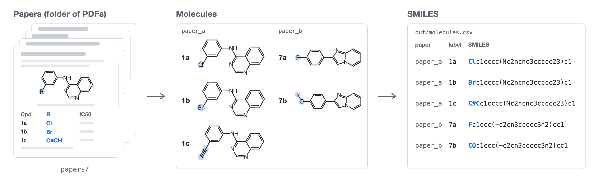
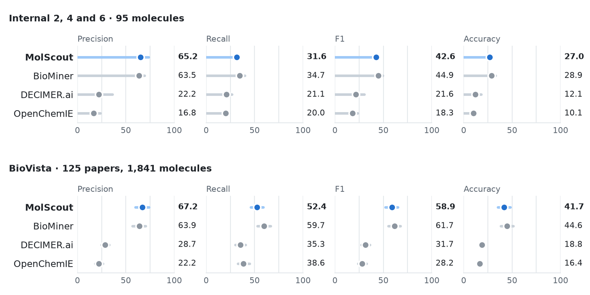

<div align="center">

<h1>MolScout</h1>

<p>Extract every molecule in a chemistry paper as canonical SMILES.</p>

<p>
  <a href="https://www.python.org/downloads/"></a>
  <a href="LICENSE"></a>
</p>

<p>
  <a href="#install">Install</a> ·
  <a href="#quick-start">Quick start</a> ·
  <a href="docs/pipeline.md">Pipeline</a> ·
  <a href="docs/benchmarks.md">Benchmarks</a> ·
  <a href="#results">Results</a> ·
  <a href="#citation">Citation</a>
</p>

<picture>
  <source media="(prefers-color-scheme: dark)" srcset="docs/figures/hero-dark.png">
  
</picture>

</div>

MolScout reads each paper's text, tables and structure drawings, then joins them into one list of
molecules. Each molecule carries its compound label, page, bounding box and a review status, so it
can be checked against the PDF. R-group tables are expanded into one molecule per row, and every
stage reports how many records it received and produced.

## Results

Whole-paper extraction on two sets: BioVista, 145 public papers with 2,304 molecules (Yan et al.,
2026), and Internal, six private medicinal-chemistry papers with 220 molecules. Each system is
scored by exact match of canonical SMILES (RDKit 2026.3.2), stereochemistry included, as micro
precision (P), recall (R), F1 and accuracy (Acc) over distinct molecules, in %. Accuracy is
TP / (TP + FP + FN), since a list of extracted molecules has no true negatives.

**Held-out papers:** Internal 2, 4 and 6 (95 molecules) and 125 BioVista papers (1,841 molecules).
MolScout's configuration was frozen on the other papers, Internal 1, 16 and 19 and 20 BioVista
papers.

| System | Internal P | Internal R | Internal F1 | Internal Acc | BioVista P | BioVista R | BioVista F1 | BioVista Acc |
|:--|--:|--:|--:|--:|--:|--:|--:|--:|
| **MolScout** | 65.2 | 31.6 | 42.6 | 27.0 | 67.2 | 52.4 | 58.9 | 41.7 |
| BioMiner | 63.5 | 34.7 | 44.9 | 28.9 | 63.9 | 59.7 | 61.7 | 44.6 |
| DECIMER.ai | 22.2 | 21.1 | 21.6 | 12.1 | 28.7 | 35.3 | 31.7 | 18.8 |
| OpenChemIE | 16.8 | 20.0 | 18.3 | 10.1 | 22.2 | 38.6 | 28.2 | 16.4 |

MolScout is scored with the `both` joiner: the `rules` joiner (OPSIN and RDKit) merged with
BioMiner-Instruct, a 32B model served by vLLM. It has the highest precision on both sets. BioMiner
has the highest recall, F1 and accuracy, with F1 2.3 points above MolScout on Internal and 2.8 on
BioVista, where the two systems' 95% intervals overlap. Both reach about twice the F1 of DECIMER.ai
and OpenChemIE.

<picture>
  <source media="(prefers-color-scheme: dark)" srcset="docs/figures/systems_heldout-dark.png">
  
</picture>

Development-paper scores, the ladder of fixes and six structure readers:
[docs/results.md](docs/results.md). Datasets, baselines and scoring:
[docs/benchmarks.md](docs/benchmarks.md).

## Install

Requires Python 3.11 or later, [uv](https://docs.astral.sh/uv/) and Java (for OPSIN).

```bash
git clone https://github.com/as-obaid/MolScout.git
cd MolScout
uv sync
```

The parsing, segmentation and reading stages run in their own tool environments under
`$MOLSCOUT_STORE/envs/`, built by each tool's `setup.sh`
([docs/reproduce.md](docs/reproduce.md#3-tool-environments)). The `rules` mode runs on a CPU or one
16–24 GB GPU. The `32b` and `both` modes serve a 32B model (63 GB of weights) and need one NVIDIA
H200; `benchmarks/tools/complete_systems/biominer/setup.sh` builds its environments and downloads
it.

## Quick start

```bash
uv run molscout run papers/ -o out/
```

MolScout reads every PDF in `papers/`. It writes one `out/papers/<paper_id>/molecules.csv` per paper
and one combined `out/molecules.csv`, plus the intermediate files of every stage
([docs/pipeline.md](docs/pipeline.md#work-directory)).

This uses the `rules` joiner. The `both` joiner, which MolScout is scored with, also needs
BioMiner-Instruct served by vLLM. After the `rules` run, start the server and run again into the same
folder. The second run reuses the finished stages and starts at the 32B join:

```bash
bash src/molscout/pipeline/workers/serve_32b.sh &     # serves on 127.0.0.1:8613
curl -s http://127.0.0.1:8613/v1/models               # wait until this lists the model
uv run molscout run papers/ -o out/ --joiner both --vllm-url http://127.0.0.1:8613/v1
```

Details are in [docs/reproduce.md](docs/reproduce.md#6-molscout).

| Column | Meaning |
|:--|:--|
| `paper_id` | Paper identifier, from the PDF's file name |
| `label` | Compound label as printed in the paper, such as `12a`; empty when none is found |
| `smiles` | Canonical SMILES (RDKit) |
| `page` | Page number, starting at 1 |
| `bbox` | `x0,y0,x1,y1` in PDF points, origin at the top left: the drawing, or the table row |
| `source` | `drawn` (read from a drawing), `table` (built from an R-group table row), `name` (built from a chemical name with OPSIN), `32b` (from the 32B joining model) |
| `status` | `accepted`: passed every check. `review`: kept, but a check failed or could not run. `abstained`: no structure given; the reason is recorded in `molecules.jsonl` |
| `confidence` | 0 to 1; higher when the readers agree and the checks pass |

## Reproduce the benchmarks

Every committed number can be rebuilt: fetch the public data, build each tool's environment, run
its config and score it. See [docs/reproduce.md](docs/reproduce.md). Datasets, baselines and scoring
rules are in [docs/benchmarks.md](docs/benchmarks.md).

```bash
uv sync --extra dev
uv run pytest -q
uv run python scripts/fetch_data.py uspto
uv run molscout bench benchmarks/configs/molscribe__uspto.yaml
```

MolScout's own runs use the `molscout*` configs in the same folder
([docs/reproduce.md](docs/reproduce.md#6-molscout)).

## Repository

```
src/molscout/          package: pipeline, scoring, data loaders, benchmark harness
benchmarks/tools/      one wrapper and setup script per baseline tool
benchmarks/configs/    one config per tool and dataset
benchmarks/results/    committed predictions, scores and run metadata
data/manifests/        dataset manifests, checksums and frozen splits
scripts/               data download, configs, charts, W&B upload
docs/                  pipeline, benchmarks, results, reproduction
```

## Licence

MolScout is released under the [MIT licence](LICENSE).

It runs or bundles the components below, each under its own licence. Each entry was checked against
the project's repository, model card or archive record on 2026-11-25.

| Component | Used for | Licence | Checked |
|:--|:--|:--|:--|
| [MinerU](https://github.com/opendatalab/MinerU) 4.2.3 | parsing text and tables | Apache-2.0 with additional terms: a separate licence above 100 million monthly users or USD 20 million monthly revenue, and online services must state that they use MinerU | `LICENSE.md` |
| [MinerU2.5-Pro](https://huggingface.co/opendatalab/MinerU2.5-Pro-2605-1.2B) 1.2B | table model in MinerU's standard tier | Apache-2.0 | model card |
| [pypdfium2](https://github.com/pypdfium2-team/pypdfium2) | rendering pages | Apache-2.0 or BSD-3-Clause; PDFium is BSD-style | README |
| [DECIMER Segmentation](https://github.com/Kohulan/DECIMER-Image-Segmentation) | finding drawings | MIT; weights CC BY 4.0 ([Zenodo 10142866](https://zenodo.org/records/10142866)) | `LICENSE`, Zenodo |
| [DECIMER Image Classifier](https://github.com/Iagea/DECIMER-Image-Classifier) | dropping non-structures | MIT, declared in `setup.py`; the repository has no licence file | `setup.py` |
| [MolGlyph](https://huggingface.co/jiaxianustc/MolGlyph) | reading drawings | MIT; weights gated on Hugging Face (access on request) | model card |
| [MolScribe](https://github.com/thomas0809/MolScribe) | reading drawings | MIT (code and weights) | `LICENSE`, model card |
| [MolNexTR](https://github.com/CYF2000127/MolNexTR) | reading drawings | Apache-2.0 (code and weights) | `LICENSE`, dataset card |
| [OPSIN](https://github.com/dan2097/opsin) | names to structures | MIT | `LICENSE.txt` |
| [RDKit](https://github.com/rdkit/rdkit) | chemistry and scoring | BSD-3-Clause | `license.txt` |
| [BioMiner-Instruct](https://huggingface.co/jiaxianustc/BioMiner-Instruct) | `32b` and `both` modes only | **Not stated.** The gated model card declares no licence. It is a LoRA fine-tune of Qwen3-VL-32B-Instruct (Apache-2.0), and BioMiner's code is MIT. | model card metadata |
| [vLLM](https://github.com/vllm-project/vllm) | serving the 32B model | Apache-2.0 | `LICENSE` |
| MolRecBench-Wild evaluator table | scoring MolRecBench-Wild (bundled as `carbon_templates.json.gz`) | Apache-2.0; copy in `src/molscout/data/carbon_templates.LICENSE` | bundled licence |
| [MolDetV2](https://huggingface.co/UniParser/MolDetv2) | inside BioMiner, a benchmarked baseline only; not used by MolScout | CC BY-NC-SA 4.0 | model card |

Paper PDFs are not redistributed. BioVista PDFs are downloaded from open-access sources by
`scripts/fetch_data.py`.

## Citation

If you use MolScout, cite it with the metadata in [CITATION.cff](CITATION.cff):

```bibtex
@software{obaidullah2026molscout,
  author  = {Obaidullah, Muhammad},
  title   = {MolScout: Molecules from Chemistry Papers as Canonical SMILES},
  year    = {2026},
  version = {0.1.0},
  url     = {https://github.com/as-obaid/MolScout}
}
```

Please also cite the tools MolScout builds on; references are listed in
[docs/pipeline.md](docs/pipeline.md#references) and [docs/benchmarks.md](docs/benchmarks.md#references).

## References

- Yan, J., et al. (2026). BioMiner: A multi-modal system for automated mining of protein-ligand
  bioactivity data from literature. arXiv:2604.21508.
