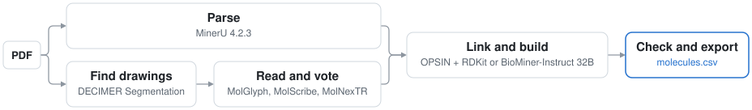

# Pipeline

MolScout turns a paper PDF into the canonical SMILES of every molecule the paper defines, with one
molecule for each row of an R-group table. It reads the paper twice, once as text and tables and once
as structure drawings, and joins the two readings. Each molecule keeps its compound label, page,
box, source and status, so every row can be checked against the PDF.

<picture>
  <source media="(prefers-color-scheme: dark)" srcset="figures/pipeline-dark.svg">
  
</picture>

## Stages

| Stage | What it does | Tools |
|:--|:--|:--|
| Parse | Extracts text blocks, tables as HTML cells and captions, each with its page and box | MinerU 4.2.3 |
| Find drawings | Renders each page at 300 dpi, crops every structure drawing and every drawn table cell, and sets aside crops that are not structures | pypdfium2, DECIMER Segmentation 1.3.0, DECIMER Image Classifier |
| Read and vote | Reads every crop with three readers and keeps the structure most of them agree on | MolGlyph, MolScribe, MolNexTR |
| Link and build | Ties drawings to compound labels and builds table rows, scheme compounds and named compounds | OPSIN and RDKit, or BioMiner-Instruct 32B ([joiners](#joiners)) |
| Check and export | Rejects invalid structures, compares printed formulas, applies the relevance rule, merges duplicates and writes `molecules.csv` | RDKit |

Text and drawings are read separately and meet at Link and build. The one crossing is that Find
drawings takes the table images Parse keeps, to crop drawn table cells.

The runner takes one stage at a time across all papers, so each model loads once per run. A rerun
skips every stage whose settings, code and inputs are unchanged. `stages.json` holds each stage's
counts in and out, time, peak GPU memory and errors. When a parsing, segmentation, reading or linking
stage gets input and writes nothing, or a stage's counts do not add up, the paper is marked failed
rather than returning a shorter list.

### Parse

MinerU 4.2.3 (Wang et al., 2024) parses each PDF locally, with telemetry off. On a GPU it runs its
standard tier, whose table model is the 1.2B MinerU2.5-Pro vision-language model (Niu et al., 2025).
On a CPU it runs its basic tier. Each caption is tied to its figure or table.

### Find drawings

pypdfium2 renders each page at 300 dpi. DECIMER Segmentation (Rajan et al., 2021) crops each
structure drawing, and the DECIMER Image Classifier marks the crops that are not structures, which
skip the readers.

Drawings inside table cells (R groups or whole compounds) get crops of their own. MinerU keeps such a
cell as a 200 dpi image without a position. Each image is found on the 300 dpi page by normalized
cross-correlation and cut from there, and DECIMER Segmentation also runs over the table to recover
drawings MinerU dropped. A crop that holds the drawings of two rows is split at the white gap between
them. Cell crops always reach the readers, since a small fragment can score as a non-structure.

### Read and vote

MolGlyph (Yan et al., 2026), MolScribe (Qian et al., 2023) and MolNexTR (Chen et al., 2024) read every
crop. R-group attachment points stay as numbered dummy atoms (`[*:1]`) with their drawn labels (R1,
X), so Link and build can fill them.

- Reads are grouped by connectivity: the InChIKey's first block, or for an R-group core its canonical
  SMILES with bare dummies. The largest group wins and a tie gives no structure. Confidence is the
  winning group's share of the three readers.
- Stereochemistry is kept only when every read in the winning group has the same stereo. Otherwise it
  is removed.
- A core's slot labels must agree too. With `slot_labels`, an even split takes the labelling of the
  first reader in the order MolGlyph, MolScribe, MolNexTR, and the other labellings stay as
  alternatives for a table's columns to settle.
- MolGlyph writes a wavy attachment bond as `*`. MolScribe and MolNexTR often read it as a short
  carbon chain or leave it out. With `attachments`, when the vote gives a whole molecule or a tie, a
  core read with `*` is kept as an alternative if the plain reads match it with each `*` read as H or a
  short alkyl group.
- A table-cell crop must give an R group with exactly one attachment point. A methyl or a radical in a
  plain read can stand for the attachment, and with `attachments` so can an ethyl or propyl group or a
  missing hydrogen. The fragment that at least one reader drew with `*` and most readers support wins.
  When no reader drew an attachment, the plain vote may give a whole molecule.

### Link and build

This is the `rules` joiner; [Joiners](#joiners) describes the 32B model.

- **Labels.** A drawing and a compound label printed below or beside it link when each is the
  other's nearest. Labels come from MinerU's text and, inside figure images, from MinerU's PP-OCRv6
  models, which read each figure and the area around each drawing. Ranges such as `12a–f` expand to
  one label each. Text inside a drawing (atom symbols, ring numbers) is not a label.
- **R-group tables.** A table with a label column and variable columns (R1, X, Ar) takes its core from
  the drawings with numbered slots on its page, nearest first, then the page before. With
  `core_check`, a core whose slot labels match the columns wins over a nearer one that does not, since
  a misread core repeats its error in every row. The slots are filled row by row. Substituents
  resolve through abbreviations (OMe, CF3, Ph), formula and shorthand rules, or OPSIN (Lowe et al.,
  2011). A drawn substituent comes from its cell crop's vote, placed by the row label's position in
  the PDF's text when MinerU dropped or misplaced the image. RDKit's `molzip` joins the pieces. Rows of
  a core that fails the check, or that fewer than two readers agree on, go to `review`.
- **Whole-compound tables.** A table with a label column, no variable columns and a column of
  drawings gives one molecule per row, from that row's drawing.
- **Schemes.** A line such as `20, R = Boc` printed beside a core in a figure fills the nearest core on
  its page with exactly those slot labels and gives one molecule, labelled `20`.
- **Names.** Systematic names printed with a compound label, mostly in the experimental section,
  become molecules through OPSIN.

Every table row gives a record. A row that cannot be built is `abstained` with its reason, and a
table with records for fewer rows than it has stops the paper with an error.

### Check and export

The molecules of every joiner pass the same checks, in this order:

1. **Junk.** Invalid SMILES, leftover R slots, radicals, structures under 5 heavy atoms, acyclic
   all-carbon chains of 40 or more atoms, and mixtures of pieces that are not salts or solvents are
   `abstained`. A listed salt or solvent beside the parent is removed.
2. **Formulas.** When the paper prints a molecular formula for the molecule's label (an adduct such
   as `[M+H]+` is converted back), a match raises the confidence and a mismatch sends an accepted
   molecule to `review`. Printed formulas contain typos, so a mismatch never rejects.
3. **Relevance.** A drawn or table molecule stays `accepted` with a compound label, or without one at
   20 or more heavy atoms. A smaller unlabelled molecule goes to `review`. A molecule read only from a
   name also needs its label in an activity table or sentence (IC50, Ki, EC50 and similar) when the
   paper has one. On the BioVista development papers, named molecules outside activity tables and
   sentences were rarely in the answer key, while labelled drawn and table molecules mostly were.
4. **Duplicates.** Molecules with the same label and connectivity become one record, the one with the
   best status.

## Joiners

| Joiner | How text and drawings are joined | Hardware |
|:--|:--|:--|
| `rules` | OPSIN, RDKit and the rules of [Link and build](#link-and-build) | CPU, or one 16–24 GB GPU |
| `32b` | BioMiner-Instruct (Yan et al., 2026), a 32B vision-language model served by vLLM, replaces the rules. With BioMiner's prompts it links drawings to labels and reads R-group tables | one NVIDIA H200 |
| `both` | The rules first, then the 32B molecules check and fill them | one NVIDIA H200 |

In `both`, a 32B molecule with the same connectivity raises a rules molecule's confidence and gives it
a label it lacks. A 32B molecule that has a rules molecule's label but another structure is left out.
32B rows fill table rows the rules could not build and tables with missing rows. Every other 32B
molecule joins as `review`.

`both` is the benchmarked configuration, chosen on the development papers
([results.md](results.md#the-ladder)). `molscout run` defaults to `rules`, which needs no H200; pass
`--joiner both --vllm-url URL` for the benchmarked one ([reproduce.md](reproduce.md#6-molscout)).

## Fixes

Each fix is a switch under `fixes:` in `src/molscout/pipeline/pipeline.yaml`, and
`molscout run --fixes-off NAME,...` switches fixes off for one run. The benchmarked configuration
uses the defaults. [results.md](results.md#the-ladder) measures what each fix adds.

| Fix | Default | What it does |
|:--|:--|:--|
| `labels` | on | Links each drawing to its compound label |
| `relevance` | on | Applies the relevance rule of Check and export |
| `tables` | on | Builds R-group table rows, whole-compound table rows and scheme compounds |
| `core_check` | on | Prefers a core whose slot labels match the table's columns; rows of a core that matches none go to `review` |
| `vote` | on | Lets three readers vote; off, each crop takes MolGlyph's read |
| `stereo` | on | Keeps stereochemistry only when the agreeing readers agree on it; off, removes it from every vote |
| `junk` | on | Applies the junk rejections and salt removal of Check and export |
| `names` | on | Builds named compounds with OPSIN |
| `formulas` | on | Compares each molecule with its printed formula |
| `attachments` | on | Reads short chains and missing hydrogens as attachment points, and keeps `*` cores as alternatives |
| `slot_labels` | on | Settles a core whose readers split on its slot labels, by reader order and then by the table's columns |
| `legends` | off | Fills table codes such as `M0` from the drawing labelled with each code; it changed nothing on the development papers |
| `partial_stereo` | off | Leaves reads without any stereo out of the stereo test; it lost molecules and gained none on the development papers |

## Output

`molscout run PAPERS -o OUT` writes `OUT/molecules.csv`: every molecule of every paper, with
`paper_id, label, smiles, page, bbox, source, status, confidence` (see the
[README](../README.md#quick-start) for each column). The status says how far to trust a row:

- `accepted`: built, and passed every check.
- `review`: kept, but a check failed, such as a formula mismatch, a core fewer than two readers agree
  on, a small unlabelled molecule or a molecule only the 32B model found.
- `abstained`: no structure could be given. The SMILES is empty and the reason is in
  `molecules.jsonl`.

With `--dataset`, the run also writes `OUT/predictions.csv` for `molscout score`. It holds the
statuses `--export` names: `accepted` by default, or `accepted+review`.

### Work directory

Each paper's stage files are in `OUT/papers/<paper_id>/`, with that paper's own `molecules.csv`.
Pages are 1-based. Boxes are `[x0, y0, x1, y1]` in PDF points with the origin at the top left.

| File | One record per | Fields |
|:--|:--|:--|
| `pages.jsonl` | page | `page, width_pt, height_pt, image, dpi, vector` |
| `layout.jsonl` | text block, table, caption | `page, index, type, bbox, text, html, parent, image` |
| `regions.jsonl` | drawing | `region_id, page, bbox, crop, structure_score, is_structure, kind` (`drawing` or `cell`) |
| `ocr.jsonl` | text line in a figure | `page, bbox, text, score, source_block` |
| `cells.jsonl` | table-cell drawing | `region_id, table, page, row, col, src, part, parts, method, match, bbox` |
| `reads.jsonl` | drawing and reader | `region_id, reader, smiles, slots, error` |
| `voted.jsonl` | drawing | `region_id, smiles, inchikey, agree, stereo_kept, confidence, readers, slots, reason, skeleton_agree, alternatives` |
| `molecules_rules.jsonl`, `molecules_32b.jsonl`, `molecules_merged.jsonl` | molecule, before the checks | as `molecules.jsonl` |
| `molecules.jsonl` | molecule | `paper_id, label, smiles, page, bbox, source, table_id, row, status, reasons, confidence` |
| `molecules.csv` | molecule | `paper_id, label, smiles, page, bbox, source, status, confidence` |
| `stages.json` | stage | `records_in, records_out, counts, seconds, peak_gpu_mb, errors` |

## References

- Chen, Y., et al. (2024). MolNexTR: a generalized deep learning model for molecular image
  recognition. *Journal of Cheminformatics*, 16. https://doi.org/10.1186/s13321-024-00926-w
- Lowe, D. M., et al. (2011). Chemical name to structure: OPSIN, an open source solution. *Journal
  of Chemical Information and Modeling*, 51(3). https://doi.org/10.1021/ci100384d
- Niu, J., et al. (2025). MinerU2.5: A decoupled vision-language model for efficient
  high-resolution document parsing. arXiv:2509.22186.
- Qian, Y., et al. (2023). MolScribe: Robust molecular structure recognition with image-to-graph
  generation. *Journal of Chemical Information and Modeling*, 63(7).
  https://doi.org/10.1021/acs.jcim.2c01480
- Rajan, K., et al. (2021). DECIMER-Segmentation: Automated extraction of chemical structure
  depictions from scientific literature. *Journal of Cheminformatics*, 13.
  https://doi.org/10.1186/s13321-021-00496-1
- Wang, B., et al. (2024). MinerU: An open-source solution for precise document content extraction.
  arXiv:2409.18839.
- Yan, J., et al. (2026). BioMiner: A multi-modal system for automated mining of protein-ligand
  bioactivity data from literature. arXiv:2604.21508.
