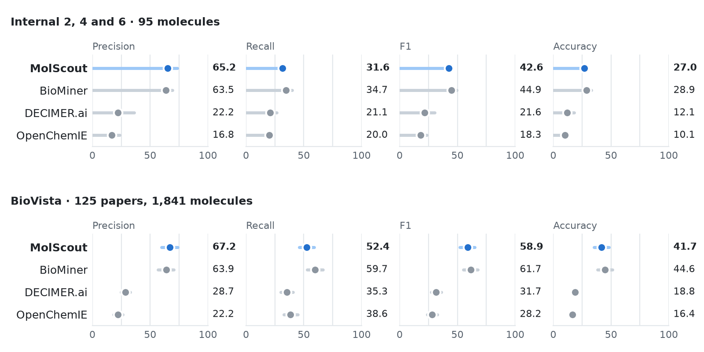
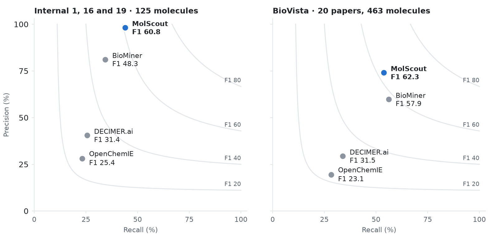
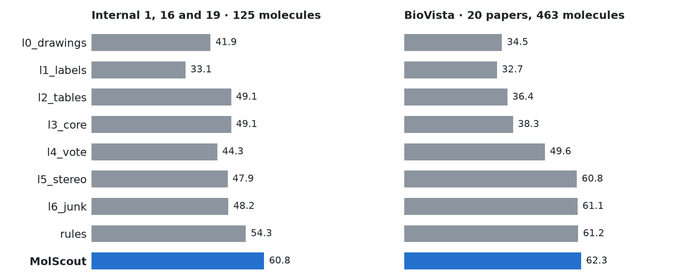
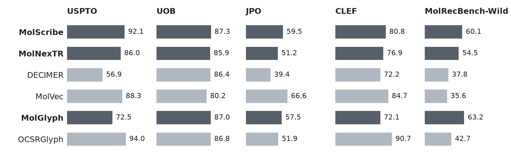

# Results

MolScout is compared with three complete PDF-to-SMILES systems, BioMiner, DECIMER.ai and
OpenChemIE, on whole papers from BioVista (Yan et al., 2026) and Internal. Each system is scored
over distinct molecules, stereochemistry included, by micro precision (P), recall (R), F1 and
accuracy (Acc), in %. TP counts correct molecules, FP extra or wrong ones and FN missed ones.
Accuracy is TP / (TP + FP + FN): a list of extracted molecules has no true negatives, so
(TP + TN) / all reduces to it.

## Held-out papers

Internal 2, 4 and 6 (95 molecules) and the 125 BioVista papers outside the development set (1,841
molecules). MolScout here is the frozen `both` joiner (`benchmarks/results/molscout__<dataset>`).

| System | Internal P | Internal R | Internal F1 | Internal Acc | BioVista P | BioVista R | BioVista F1 | BioVista Acc |
|:--|--:|--:|--:|--:|--:|--:|--:|--:|
| **MolScout** | 65.2 | 31.6 | 42.6 | 27.0 | 67.2 | 52.4 | 58.9 | 41.7 |
| BioMiner | 63.5 | 34.7 | 44.9 | 28.9 | 63.9 | 59.7 | 61.7 | 44.6 |
| DECIMER.ai | 22.2 | 21.1 | 21.6 | 12.1 | 28.7 | 35.3 | 31.7 | 18.8 |
| OpenChemIE | 16.8 | 20.0 | 18.3 | 10.1 | 22.2 | 38.6 | 28.2 | 16.4 |

<picture>
  <source media="(prefers-color-scheme: dark)" srcset="figures/systems_heldout-dark.png">
  
</picture>

**Figure 1.** Held-out papers: precision, recall, F1 and accuracy per system. Dot: the score;
line: its 95% paper-bootstrap interval.

MolScout has the highest precision on both datasets: 65.2 against BioMiner's 63.5 on Internal, and
67.2 against 63.9 on BioVista. BioMiner has the highest recall, F1 and accuracy. Its F1 is 2.3
points above MolScout's on Internal and 2.8 on BioVista, where the 95% intervals overlap (MolScout
52.2 to 65.1, BioMiner 55.3 to 67.8). Internal has three held-out papers, so its intervals are wide.
MolScout and BioMiner both reach about twice the F1 of DECIMER.ai and OpenChemIE. For context, the
best autonomous AI-agent run reported by Gulluoglu et al. (2026) reached about 21% precision and 11%
recall.

From the development to the held-out papers, MolScout's precision falls from 98.2 to 65.2 on
Internal and from 74.1 to 67.2 on BioVista. Its BioVista recall holds (53.8, then 52.4), while
BioMiner's rises from 56.2 to 59.7. On 3 of the 125 held-out BioVista papers MolScout writes no
molecule, missing 13: DECIMER finds no structure drawing in two of them, and in the third the link
stage drops all five records.

## Development papers

MolScout's configuration was chosen on these papers: Internal 1, 16 and 19 (125 molecules) and the
20 BioVista papers in `data/manifests/biovista_dev.csv` (463 molecules). MolScout here is the
frozen `both` joiner (`benchmarks/results/molscout_both__<dataset>`); the scored runs,
`molscout__<dataset>`, cover these papers too and give the same counts. The `rules` joiner on its
own is the last step before MolScout in [the ladder](#the-ladder).

| System | Internal P | Internal R | Internal F1 | Internal Acc | BioVista P | BioVista R | BioVista F1 | BioVista Acc |
|:--|--:|--:|--:|--:|--:|--:|--:|--:|
| **MolScout** | 98.2 | 44.0 | 60.8 | 43.7 | 74.1 | 53.8 | 62.3 | 45.3 |
| BioMiner | 81.1 | 34.4 | 48.3 | 31.9 | 59.8 | 56.2 | 57.9 | 40.8 |
| DECIMER.ai | 40.5 | 25.6 | 31.4 | 18.6 | 29.4 | 33.9 | 31.5 | 18.7 |
| OpenChemIE | 28.2 | 23.2 | 25.4 | 14.6 | 19.5 | 28.3 | 23.1 | 13.0 |

<picture>
  <source media="(prefers-color-scheme: dark)" srcset="figures/systems_dev-dark.png">
  
</picture>

**Figure 2.** Development papers: precision against recall; grey curves join points of equal F1.

MolScout has the highest F1 and accuracy on both datasets. Its edge is precision: 98.2 against
BioMiner's 81.1 on Internal, and 74.1 against 59.8 on BioVista. BioMiner has the higher BioVista
recall, 56.2 against 53.8.

### The ladder

Each step is the `rules` joiner with one more group of fixes switched on
(`benchmarks/configs/molscout_<step>__<dataset>.yaml`); [pipeline.md](pipeline.md#fixes) describes
each fix. `legends` and `partial_stereo` are off in every step.

<picture>
  <source media="(prefers-color-scheme: dark)" srcset="figures/ladder-dark.png">
  
</picture>

**Figure 3.** Development F1 at each step of the ladder.

| Step | Fixes added |
|:--|:--|
| `l0_drawings` | none: every drawing, read by MolGlyph alone |
| `l1_labels` | `labels`, `relevance` |
| `l2_tables` | `tables` |
| `l3_core` | `core_check` |
| `l4_vote` | `vote` |
| `l5_stereo` | `stereo` |
| `l6_junk` | `junk` |
| `rules` | `names`, `formulas`, `attachments`, `slot_labels` |
| MolScout (`both`) | the 32B joiner, merged with `rules` |

With one fix switched off, the `rules` joiner scores 54.3 F1 on Internal and 60.2 on BioVista
without `attachments`, and 50.9 and 61.2 without `slot_labels`.

## Structure readers

<picture>
  <source media="(prefers-color-scheme: dark)" srcset="figures/crop_accuracy-dark.png">
  
</picture>

**Figure 4.** Exact-match accuracy (%) of six structure readers on five crop datasets,
stereochemistry included. Bold: the three readers MolScout votes with.

Journal drawings are the hard case: the best reader scores 94.0 on USPTO patent crops but 63.2 on
MolRecBench-Wild, which is cropped from journal articles. MolGlyph, MolScribe and MolNexTR are the
three best readers on MolRecBench-Wild. The table is in
[benchmarks.md](benchmarks.md#structure-readers-on-crops).

## References

- Gulluoglu, H. S. A., et al. (2026). Practical use of advanced AI frameworks on real-life
  scientific problems: Three case studies. *bioRxiv*. https://doi.org/10.64898/2026.06.23.734132
- Yan, J., et al. (2026). BioMiner: A multi-modal system for automated mining of protein-ligand
  bioactivity data from literature. arXiv:2604.21508.
